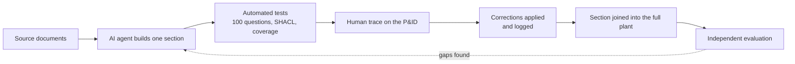

# CCPP Knowledge Graph

**A knowledge graph of the Imperial College carbon capture pilot plant (CCPP), built with an AI agent, and a study of how much human input that agent needs.**

Autonomous Industrial Systems Lab (AISL), Department of Chemical Engineering, Imperial College London
MEng research project: James Williams. Supervisor: Dr Mehmet Mercangöz.

---

## Contents

1. [Why this project exists](#why-this-project-exists)
2. [The research question](#the-research-question)
3. [What the knowledge graph contains](#what-the-knowledge-graph-contains)
4. [How the graph is built](#how-the-graph-is-built)
5. [How quality and human input are measured](#how-quality-and-human-input-are-measured)
6. [Current status](#current-status)
7. [Repository layout](#repository-layout)
8. [Getting started](#getting-started)
9. [Adding or correcting knowledge](#adding-or-correcting-knowledge)
10. [Roadmap](#roadmap)

---

## Why this project exists

Autonomous systems for process plants (supervisory agents, operator assistants, fault diagnosis) need a machine-readable model of the plant: what is connected to what, what each instrument measures, how each control loop works, what can go wrong, and what to do about it. On most plants that knowledge is spread across drawings, HAZOP studies, reports and procedures, written for people rather than machines.

This project turns that documentation into a **knowledge graph (KG)** for the CCPP, so that it can be used as the plant model in the development of autonomous systems for the pilot plant, and in the wider study of integrating autonomous systems on the CCPP. The first application is a **chatbot with an interactive P&ID**, which answers operating and cause-and-effect questions with a cited source for every claim.

## The research question

> **How well can an agentic AI build a knowledge graph of a process plant, and how does the amount of human input change the result?**

The KG in this repository (**KG A**) was built with the most human input: in small sections, each one traced against the P&ID by the team and corrected. It is compared with two graphs built from the **same documents** with less input:

| KG | How it is built | Human input |
|---|---|---|
| **A** (this repository) | 13 sections, each traced on the P&ID, corrected and tested | High |
| **B** | A few large parts, one time-boxed human review per part | Medium (planned) |
| **C** | The whole plant in one go, from the files and a single instruction | Low |

All three are tested on the **same independent question set** with the **same scoring script**, so that differences can be attributed to the build method and the human input.

## What the knowledge graph contains

The graph is written in RDF (Turtle) against the project ontology (`ontology/ccpp_ontology.ttl`). It holds:

- **Equipment, valves and instruments**, with tag, type, P&ID grid reference, floor, normal position and signal type
- **Topology**: how items are piped together and which way the process fluid flows, for each operating mode
- **Control loops and cascades**: sensor, controller and final element for each loop
- **Limits, alarms and trips**, with values and units
- **HAZOP knowledge**: every deviation row, linked to the items it concerns
- **Simulation results**: Aspen stream and equipment data, linked to the simulation case they came from
- **Procedures and alarm responses**: the documented operator actions for each alarm
- **A causal layer**: process variables and cited cause-and-effect links (for example, *loss of C400 cooling water raises E100 pressure*), so the graph can answer "what could cause this?"
- **Provenance and uncertainty**: every fact cites its source document and location, discrepancies between documents are recorded, and anything not yet confirmed is held as an **open item** saying what would resolve it

**Source documents** (summarised, not stored here): the plant P&ID and an earlier revision, a document listing P&ID differences, the 2010 HAZOP, the 2023/24 plant summary, a group pilot plant report, and the Aspen Plus models. The document register is in `stripping_loop/sources.py`.

## How the graph is built



1. **Piecewise build.** The plant is split into sections (stripping loop, absorption loop, gas feed, utilities, and so on). The agent builds one section at a time from the documents, using a shared builder (`kgkit/build_section.py`), so every section uses the same structure.
2. **Automated checks.** Each section has its own question set (up to 100 SPARQL questions with expected answers taken from the documents). The full plant is checked for conflicting facts, broken links and SHACL shape violations, and for coverage of every tag in the report's equipment, valve and instrument lists.
3. **Human tracing.** A team member traces each section's lines on the P&ID and reports what differs from the graph.
4. **Corrections.** Each correction is applied with its source and logged, so the record shows what the agent got wrong and what caught it.
5. **Evaluation.** The finished graph is tested by an independent question set (see below).

**Rules the graph follows:** no fact without a citation; inferred facts are labelled as inferred; conflicting documents are recorded rather than silently resolved; and unresolved points become open items.

## How quality and human input are measured

**Quality** is measured with an independent benchmark: questions written by a different AI model (ChatGPT) from the source documents alone, each with an expected answer and the key items any correct answer must contain. The question types are single facts, topology, multi-hop chains, control loops, cause and effect, and safety actions. `tools/test_kg_questions.py` asks each question of a graph and scores how much of the needed evidence the graph holds. It works on any RDF graph, so the same test runs on KG A, B and C.

**Human input** is recorded in an effort ledger for each KG: hours (chat and offline), messages carrying plant knowledge (traces, corrections), corrections applied, build prompts and fix cycles. Each shortfall in the benchmark is classified by root cause (missing content, missing causal link, modelling choice, retrieval, source mismatch, formatting), so the KGs can be compared by the *type* of error as well as the count.

## Current status

| Measure | KG A |
|---|---|
| Sections built | 13 (all P&ID lines, plus procedures and the causal layer) |
| Report tags covered | 335 of 335 (100%) |
| Automated questions | Over 1,000, plus SHACL and full-plant checks |
| Open items | 98, each with what would resolve it |
| Independent benchmark (80 questions, as first evaluated) | 56 supported, 18 partly supported, 6 not supported; 82% mean key-item recall |

**Findings so far:** the agent captured equipment, instruments, control loops and HAZOP knowledge reliably (79% to 94% recall by category). Human tracing mainly corrected connections the agent had inferred wrongly. The genuine gaps were procedure content and explicit cause-and-effect links, which led to two further sections (procedures and the causal layer). The evaluated version is frozen as the Git tag `kgA-research-v1`; later improvements are referred to as **KG A+**.

## Repository layout

| Folder | Contents |
|---|---|
| `ontology/` | The shared ontology (classes and properties) |
| `kgkit/` | The section builder used by every section from piece 3 onwards |
| `stripping_loop/` | Piece 1: stripper (E100) loop, reboiler, heaters, cross exchanger |
| `absorption_loop/` | Piece 2: absorber (E101) loop and trim cooler |
| `rich_link/` | Piece 3: rich MEA link between the loops |
| `overhead/` | Piece 4: stripper overhead, condenser C400, K401, reflux |
| `gas_feed/` | Piece 5: CO2 and N2 feed, K101 saturator and its water loop |
| `abs_overhead/` | Piece 6: absorber overhead, K402, vent, K403 |
| `gas_return/` | Piece 7: N2 and CO2 return loops (J102, J103) |
| `utilities/` | Piece 8: steam and cooling water |
| `mea_storage/` | Piece 9: MEA storage, filling and draining |
| `fill_in/` | Piece 10: remaining report tags (gauges, drains, spare valves) |
| `vents_n2/` | Piece 11: vents, N2 blanket header, make-up water |
| `procedures/` | Piece 12: alarm responses and operating envelopes |
| `causal/` | Piece 13: the causal layer |
| `ccpp/` | Joins all sections into `full_plant.ttl`; full-plant tests; the build-and-test runner |
| `tools/` | Coverage check, benchmark scoring, and the cause-and-effect answering tool |
| `results/` | Benchmark results for each KG |

Each section folder holds `<section>_data.py` (the knowledge, with citations), the built `<section>.ttl`, and `ask_100_<section>.py` (its question set).

## Getting started

```bash
git clone https://github.com/AISL-at-Imperial-College-London/ccpp_kg.git
cd ccpp_kg
python3 -m venv .venv
source .venv/bin/activate
pip install rdflib pyshacl
```

**Build every section, join them and run all tests:**

```bash
python ccpp/build_and_test_all.py
```

**Ask the graph a cause-and-effect question:**

```bash
python tools/kg_answer.py "The pressure in E100 is rising. What could be causing it, and what protects against it?"
```

**Run the independent benchmark on a graph:**

```bash
python tools/test_kg_questions.py questions.json ccpp/full_plant.ttl ontology/ccpp_ontology.ttl --name KG_A
```

The joined graph, `ccpp/full_plant.ttl`, can also be loaded into any RDF tool (for example GraphDB or Protégé) and queried with SPARQL.

## Adding or correcting knowledge

- **Correcting a fact:** edit the section's `_data.py`, keep or update the citation, and run `python ccpp/build_and_test_all.py`. If a question's expected answer changes, update it in that section's question file, citing the source.
- **Adding a section:** create a folder with `<name>_data.py` and `ask_100_<name>.py` (copy the layout of an existing section), add it to `SECTIONS` in `ccpp/build_full_plant.py` and to `PIECES` in `ccpp/build_and_test_all.py`, and run the full build.
- **Pointing to the drawing:** always give the P&ID grid reference (letter row, number column), for example *PCV119 (K19)*.
- **Questions that list everything** (for example "which alarms are on LT401?") break when a later section adds a legitimate item. Write them as checks that the expected items are present.
- Never add a fact without a source. If something is uncertain, add it as an open item.

## Roadmap

- [ ] Electrical section (single-line diagram and trip matrix requested from the plant)
- [ ] Engineering review of the six cause-and-effect links based on physical reasoning
- [ ] Held-out benchmark (40 further questions) to measure KG A+ fairly
- [ ] KG B (medium input) and KG C (low input), tested on the same benchmark
- [ ] Chatbot with an interactive P&ID that highlights the items in each answer
- [ ] Remaining human traces (utilities, vents) and site checks for the open items
- [ ] Use of the graph as the plant model for autonomous system development on the CCPP

---

*Questions or suggestions: open an issue in this repository, or contact James Williams (jw2522@ic.ac.uk).*