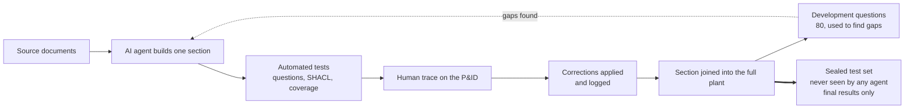

# CCPP Knowledge Graph

**A knowledge graph of the Imperial College carbon capture pilot plant (CCPP), built with an AI agent, and a study of how much human input that agent needs.**

Autonomous Industrial Systems Lab (AISL), Department of Chemical Engineering, Imperial College London
MEng research project. KG A: James Williams. KG B and KG C: Romane Nayet. Supervisor: Dr Mehmet Mercangöz.

---

## Contents

1. [Why this project exists](#why-this-project-exists)s
2. [The research question](#the-research-question)
3. [The three knowledge graphs](#the-three-knowledge-graphs)
4. [Results](#results)
5. [What we have learned so far](#what-we-have-learned-so-far)
6. [What the knowledge graph contains](#what-the-knowledge-graph-contains)
7. [How KG A is built](#how-kg-a-is-built)
8. [Repository layout](#repository-layout)
9. [Getting started](#getting-started)
10. [Adding or correcting knowledge](#adding-or-correcting-knowledge)
11. [Roadmap](#roadmap)

---

## Why this project exists

Autonomous systems for process plants (supervisory agents, operator assistants, fault diagnosis) need a machine-readable model of the plant: what is connected to what, what each instrument measures, how each control loop works, what can go wrong, and what to do about it. On most plants that knowledge is spread across drawings, HAZOP studies, reports and procedures, written for people rather than machines.

This project turns that documentation into a **knowledge graph (KG)** for the CCPP, to serve as the plant model in the development of autonomous systems for the pilot plant, and in the wider study of integrating autonomous systems on the CCPP. The first application is a **chatbot with an interactive P&ID**, which answers operating and cause-and-effect questions with a cited source for every claim.

**Source documents** (summarised, not stored here): the plant P&ID and an earlier revision, a list of P&ID differences, the 2010 HAZOP, the 2023/24 plant summary, a group pilot plant report, the Aspen Plus models and, for KG C only, the plant Control Philosophy. The document register is in `stripping_loop/sources.py`.

## Role of AI in this project

The AI is **the subject of the study, not just a helper**. An LLM agent (Claude) wrote the knowledge graphs: it read the documents, chose the structure, wrote the code that builds each graph, and wrote each section's tests. The team's role was the variable being studied: in KG A the team traced the agent's work on the P&ID and fed corrections back; in KG C the team gave one instruction and no corrections. The project measures how good the agent's graph is at each level of human input.

Three different model families are used, so that no model checks its own work: **Claude** builds the graphs, **ChatGPT** wrote the development questions from the documents alone, and **Gemini** grades the answers blind (see [How quality is measured](#how-quality-is-measured)).

## The research question

> **How well can an agentic AI build a knowledge graph of a process plant, and how does the amount of human input change the result?**

Three KGs of the same plant were built by an LLM (Claude) with different levels of human input, then tested on the **same 80 independent questions** with the **same thresholds**.

## The three knowledge graphs

| | **KG A** (this repository) | **KG B** | **KG C** |
|---|---|---|---|
| **Human input** | High | Medium | Low |
| **Build method** | 11 sections plus 2 later ones, each built, tested (up to 100 questions per section) and traced on the P&ID by the team, then corrected | Three loop KGs (stripping, absorption, cooling water) built separately, the stripping loop with team traces, then merged and the rest of the plant added in one session | One session from all source files, with no tracing or corrections |
| **Source documents** | Common set | Common set | Common set plus the Control Philosophy |
| **Size at assessment** | 22,728 triples; 335 of 335 report tags | 46,881 triples; 420 tagged items; 3,462 citations | 29,064 triples; 649 tagged items; 1,992 citations |
| **Human time** | 13.7 h logged (6 to 27 Oct) plus about 40 h estimated | Merge: about 1 h; component builds not measured | One session (about 1 h of build time) |
| **Plant-knowledge messages from the team** | 15 of 112 (6 to 27 Oct) | 0 in the merge; inherited from the component builds | 0 |
| **Corrections from human traces** | About 32, plus about 14 found by the agent | 0 in the merge; the stripping loop's traced corrections carried over | 0 |

## How quality is measured

### Question sets

| Set | Written by | Used for | Seen by the building agent? |
|---|---|---|---|
| **Development set** (80 questions) | ChatGPT, from the source documents only | First comparison of KG A, B and C; finding KG A's gaps | Its results were used to improve KG A+ |
| **Sealed test set** (planned, 40 or more) | A different writer (people and/or a second model), from the source documents only | **Final results for every KG** | **Never.** Frozen before scoring; held outside the repository until the final run |

Each question has an expected answer, its source, and 2 to 5 **key items** (tags or values) that any correct answer must contain. Questions are labelled by type (fact, topology, multi-hop, control, cause and effect, safety actions) and plant area.

### Measures

| Measure | What it answers | How it is computed |
|---|---|---|
| **Evidence recall** | Does the KG hold the facts the answer needs? | The scorer collects the KG's evidence for each question; recall = key items found ÷ key items expected. Supported ≥ 80%, partial 40 to 79%, not supported < 40% |
| **Answer correctness** (blind) | Is an answer written from the KG right? | A fixed LLM writes an answer from each KG's evidence only. **Gemini** grades every answer **blind** (KG names removed, order shuffled) against the expected answer and source, as correct / partly correct / incorrect, and marks unsupported claims. A person re-grades a random 20% to check agreement |
| **Citation support** | Does the cited source really say it? | Part of the blind grade: each claim's citation marked as supporting / not supporting |
| **Topology correctness** | Are the connections right? | A sample of each KG's connections traced on the P&ID; precision = correct connections ÷ connections checked |
| **Coverage** | Is everything on the drawings in the KG? | Report tags present ÷ report tags (335) |
| **Consistency** | Is the graph well formed? | SHACL violations, conflicting facts, broken links |
| **Effort** | How much human input went in? | Human hours (chat and offline), messages carrying plant knowledge, corrections applied |

Evidence recall depends on the retriever, so it is reported **with the same scorer and settings for every KG**. Answer correctness is the headline quality measure.

## Results

**The benchmark:** ChatGPT, given the source documents only, wrote 80 questions (12 fact, 14 topology, 14 multi-hop, 10 control, 18 cause and effect, 12 safety actions), each with an expected answer, a source and 2 to 5 key items a correct answer must contain. A scoring script finds the tags in each question, collects the KG's evidence about them (cut at 400 lines), and marks a question **supported** at 80% or more of its key items, **partial** at 40 to 79%, and **not supported** below 40%.

### Strict test (same questions, thresholds and 400-line cap)

| Category | Questions | KG A | KG B | KG C |
|---|---|---|---|---|
| Fact | 12 | 10 / 2 / 0 (94%) | 11 / 1 / 0 (97%) | 12 / 0 / 0 (100%) |
| Control | 10 | 9 / 1 / 0 (92%) | 5 / 3 / 2 (62%) | 5 / 3 / 2 (62%) |
| Cause and effect | 18 | 14 / 4 / 0 (83%) | 14 / 4 / 0 (83%) | 14 / 4 / 0 (84%) |
| Topology | 14 | 9 / 3 / 2 (80%) | 10 / 0 / 4 (70%) | 10 / 1 / 3 (77%) |
| Safety actions | 12 | 6 / 6 / 0 (79%) | 5 / 7 / 0 (73%) | 12 / 0 / 0 (90%) |
| Multi-hop | 14 | 8 / 2 / 4 (68%) | 4 / 6 / 4 (54%) | 3 / 6 / 5 (46%) |
| **All** | **80** | **56 / 18 / 6 (82%)** | **49 / 21 / 10 (74%)** | **56 / 14 / 10 (77%)** |

*Supported / partial / not supported (mean key-item recall).*

### With better retrieval (no cap, process words mapped to tags)

| | KG B | KG C |
|---|---|---|
| Supported | 72 of 80 (93% recall) | 77 of 80 (97% recall) |
| Targeted SPARQL, one query per question, checked by hand | 73 correct, 6 partly correct, 1 not answerable | Not run |

### Caveats

- **Two scorers.** KG A was scored with the original script; KG B and KG C with a re-implementation built from its description. B and C compare directly; A against B and C is approximate until all three run through one script.
- **Different corpora.** Only KG C had the Control Philosophy, on which four questions (Q17, Q25, Q28, Q53) depend.
- **Evidence, not answers.** The score measures whether the evidence holds the right items, not whether an answer written from it is correct.
- **Topology is not tested.** The questions check that items sit near each other, not that a stream runs to the right nozzle. Only KG A's connections were traced on the P&ID.
- **One question writer.** All questions and key items came from one model.

## What we have learned so far

1. **The build plan decides coverage more than human effort does.** KG A's genuine gaps (alarm-response procedures, cause-and-effect links, Control Philosophy content) were never asked for in its build. KG C was asked for them up front and holds them with no human input. KG B, asked for procedures but not causal links, closed one gap but not the other.
2. **Human input bought checked connections.** KG A's team traces made about 32 corrections that the documents alone did not reveal (for example, gas entering E101's side rather than its base, and the CO2 return entering K101). The benchmark cannot see this kind of error, and the untraced KGs show signs of it: KG B stores the gas inlet at E101's base and K403 at the wrong grid, and has one uncited, wrong link (AT100 on J100).
3. **Strict scores mostly measure retrieval.** Denser graphs (KG B and C carry citations, HAZOP links and per-mode settings on the column nodes) lose most to the 400-line cap. With better retrieval, KG B reaches 93% and KG C 97%. A chatbot needs typed, ranked retrieval rather than a line cap.
4. **Where a fact is attached matters.** KG A put the LT401 level on K401; KG B put alarm limits on the vessels rather than the transmitters. Both are defensible readings, and both cost questions. An LLM builder makes many such choices silently, so they should be recorded.
5. **Explicit causal structure works.** KG C's process-variable nodes and signed causal links answered cause-and-effect chains that KG A, as first assessed, could not (for example, more steam → hotter E100 → higher E100 pressure).

**KG A+.** After the comparison, KG A was improved with the lessons above: **piece 12** (alarm responses, thresholds and the J100 operating range from the report and HAZOP) and **piece 13** (a causal layer of 29 process variables, 17 failure events and 44 cited cause-and-effect links), plus a retrieval tool (`tools/kg_answer.py`) that walks the causal links with signs. The assessed version is frozen as the Git tag `kgA-research-v1`.

## What the knowledge graph contains

KG A is written in RDF (Turtle) against the project ontology (`ontology/ccpp_ontology.ttl`). It holds:

- **Equipment, valves and instruments**, with tag, type, P&ID grid reference, floor, normal position and signal type
- **Topology**: how items are piped together and which way the process fluid flows, for each operating mode
- **Control loops and cascades**: sensor, controller and final element for each loop
- **Limits, alarms and trips**, with values and units
- **HAZOP knowledge**: every deviation row, linked to the items it concerns
- **Simulation results**: Aspen stream and equipment data, linked to the simulation case
- **Procedures and alarm responses**: the documented operator actions for each alarm
- **A causal layer**: process variables and cited cause-and-effect links, so the graph can answer "what could cause this?"
- **Provenance and uncertainty**: every fact cites its source, discrepancies between documents are recorded, and anything unconfirmed is held as an **open item** saying what would resolve it

## How KG A is built



1. **Piecewise build.** The agent builds one section at a time from the documents, using a shared builder (`kgkit/build_section.py`).
2. **Automated checks.** Each section has its own question set with expected answers from the documents. The full plant is checked for conflicting facts, broken links, SHACL violations, and coverage of every tag in the report's equipment, valve and instrument lists.
3. **Human tracing.** A team member traces each section's lines on the P&ID and reports what differs from the graph.
4. **Corrections.** Each correction is applied with its source and logged, recording what the agent got wrong and what caught it.
5. **Evaluation.** The 80 benchmark questions are a **development set**: they were used to compare the first versions of KG A, B and C, and then to find KG A's gaps. Final results are reported only on a **sealed test set**, written separately and never shown to any building agent.

**Rules:** no fact without a citation; inferred facts are labelled as inferred; conflicting documents are recorded, not silently resolved; unresolved points become open items.

**Current state of KG A+:** 13 sections, 335 of 335 report tags, over 1,000 automated questions plus SHACL and full-plant checks, and 98 open items.

## Repository layout

| Folder | Contents |
|---|---|
| `ontology/` | The shared ontology (classes and properties) |
| `kgkit/` | The section builder used from piece 3 onwards |
| `stripping_loop/` | Piece 1: stripper (E100) loop, reboiler, heaters, cross exchanger |
| `absorption_loop/` | Piece 2: absorber (E101) loop and trim cooler |
| `rich_link/` | Piece 3: rich MEA link between the loops |
| `overhead/` | Piece 4: stripper overhead, condenser C400, K401, reflux |
| `gas_feed/` | Piece 5: CO2 and N2 feed, K101 saturator and its water loop |
| `abs_overhead/` | Piece 6: absorber overhead, K402, vent, K403 |
| `gas_return/` | Piece 7: N2 and CO2 return loops (J102, J103) |
| `utilities/` | Piece 8: steam and cooling water |
| `mea_storage/` | Piece 9: MEA storage, filling and draining |
| `fill_in/` | Piece 10: remaining report tags (gauges, drains, spare valves) |
| `vents_n2/` | Piece 11: vents, N2 blanket header, make-up water |
| `procedures/` | Piece 12: alarm responses and operating envelopes |
| `causal/` | Piece 13: the causal layer |
| `ccpp/` | Joins all sections into `full_plant.ttl`; full-plant tests; the build-and-test runner |
| `tools/` | Coverage check, benchmark scoring, and the cause-and-effect answering tool |
| `results/` | Benchmark results |

Each section folder holds `<section>_data.py` (the knowledge, with citations), the built `<section>.ttl`, and `ask_100_<section>.py` (its question set).

## Getting started

```bash
git clone https://github.com/AISL-at-Imperial-College-London/ccpp_kg.git
cd ccpp_kg
python3 -m venv .venv
source .venv/bin/activate
pip install rdflib pyshacl
```

**Build every section, join them and run all tests:**

```bash
python ccpp/build_and_test_all.py
```

**Ask the graph a cause-and-effect question:**

```bash
python tools/kg_answer.py "The pressure in E100 is rising. What could be causing it, and what protects against it?"
```

**Run the independent benchmark on a graph:**

```bash
python tools/test_kg_questions.py questions.json ccpp/full_plant.ttl ontology/ccpp_ontology.ttl --name KG_A
```

The joined graph, `ccpp/full_plant.ttl`, can also be loaded into any RDF tool (for example GraphDB or Protégé) and queried with SPARQL.

## Adding or correcting knowledge

- **Correcting a fact:** edit the section's `_data.py`, keep or update the citation, and run `python ccpp/build_and_test_all.py`. If an expected answer changes, update that section's question file, citing the source.
- **Adding a section:** create a folder with `<name>_data.py` and `ask_100_<name>.py` (copy an existing section's layout), add it to `SECTIONS` in `ccpp/build_full_plant.py` and to `PIECES` in `ccpp/build_and_test_all.py`, and run the full build.
- **Pointing to the drawing:** always give the P&ID grid reference (letter row, number column), for example *PCV119 (K19)*.
- **Questions that list everything** (for example "which alarms are on LT401?") break when a later section adds a legitimate item. Write them as checks that the expected items are present.
- Never add a fact without a source. If something is uncertain, add it as an open item.

## Roadmap

- [x] KG A, KG B and KG C built and tested on the same 80 questions
- [x] KG A+: alarm responses (piece 12) and the causal layer (piece 13)
- [ ] Run all three KGs through **one** scorer, so the comparison is exact
- [ ] Trace one section of KG C (or KG B) on the P&ID, to measure the connection errors the benchmark cannot see
- [ ] Grade written answers for about 20 questions per KG, with the same LLM and prompts
- [ ] Sealed test set (40 or more questions, never seen by any building agent) for the final results of all KGs
- [ ] Blind grading of answers by Gemini, with a 20% human check
- [ ] Typed, ranked retrieval for the chatbot, and the chatbot with an interactive P&ID
- [ ] Electrical section (single-line diagram and trip matrix requested from the plant)
- [ ] Engineering review of the causal links based on physical reasoning
- [ ] Use of the graph as the plant model for autonomous system development on the CCPP

---

*Questions or suggestions: open an issue in this repository, or contact James Williams (jw2522@ic.ac.uk) or Romane Nayet (romane.nayet23@imperial.ac.uk)*